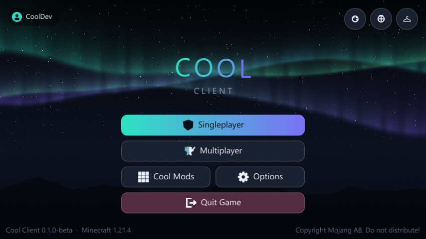

# Cool Client

A Lunar-style PvP client for **Minecraft 1.8.9** (classic PvP) and **1.21.4** (crystal PvP),
shipped as a single Fabric mod per version. It includes 60+ modules, a drag-and-drop HUD,
animated cosmetics, a custom main menu, 10 themes and shader skyboxes. The whole UI is drawn with
GPU shaders: anti-aliased SDF shapes, frosted glass and animated backgrounds.



## Is it safe?

- **Every download is built by GitHub from this source**, not on anyone's PC, and comes with
  SHA-256 checksums and a signed provenance record you can check. See [SECURITY.md](SECURITY.md).
- **Your password never touches Cool Client.** Microsoft sign-in happens on microsoft.com, and
  Cool Client's server never receives your Microsoft or Minecraft token.
- **No ads, no analytics, no hidden downloads.** The game only contacts the Cool Client server
  if you turn on online cosmetics, and the welcome screen tells you exactly what that sends.
  See [PRIVACY.md](PRIVACY.md).
- **No obfuscation.** The mod is plain Java; you (or any AI assistant) can read all of it here.

## Install

Download the jar for your Minecraft version from the
[latest release](https://github.com/XonistReal/coolclient/releases/latest).

### 1.21.4
1. Install [Fabric Loader](https://fabricmc.net/use/) 0.16 or newer for 1.21.4.
2. Put `coolclient-1.21.4-0.1.0-beta.jar` in `.minecraft/mods`.
3. Launch the Fabric 1.21.4 profile.

Fabric API is **not** required (Cool Client works with or without it).

### 1.8.9
1. Install [Legacy Fabric](https://legacyfabric.net/) Loader 0.16 or newer for 1.8.9.
2. Put `coolclient-1.8.9-0.1.0-beta.jar` in the mods folder of that profile.
3. Launch the Legacy Fabric 1.8.9 profile.

## Cool Client Launcher (coming soon)

The launcher isn't in the releases yet: it ships once it's code-signed, so Windows doesn't warn
about it. To try it now, build it from source (see [Building from source](#building-from-source)).

1. Unzip `CoolClientLauncher-0.1.0-beta-windows.zip` anywhere and run **Cool Client.exe**.
   Java is bundled, so nothing else needs installing.
2. Click the account box (bottom left) and add an account.
3. Pick **1.8.9** or **1.21.4** and press **PLAY**.

The launcher downloads Minecraft, the right mod loader (Legacy Fabric for 1.8.9, Fabric for 1.21.4),
Mojang's Java runtime and Cool Client by itself, and keeps everything in `%APPDATA%\.coolclient`.
Cosmetics and client settings are shared between both versions and the launcher's Cosmetics tab.

**Accounts.** Offline names work in singleplayer and on offline-mode servers. Microsoft sign-in
(needed for Hypixel and other online servers) uses your own Azure app ID:
1. In the [Azure portal](https://portal.azure.com) go to *App registrations*, then *New registration*,
   and choose *Personal Microsoft accounts only*.
2. Under *Authentication*, turn on *Allow public client flows*.
3. Ask Mojang to approve the app for the Minecraft API (form: <https://aka.ms/mce-reviewappid>).
4. Paste the *Application (client) ID* into the launcher's Settings, under *Microsoft app ID*.

## Controls

| Key | Action |
|---|---|
| **Right Shift** | Open Cool Client (HUD editor, mods, cosmetics, settings) |
| **C** | Zoom (scroll while zooming to adjust) |
| **Left Alt** | Freelook (disabled automatically on servers that disallow it) |
| Sprint key | Toggles sprint when Toggle Sprint is on |

In the HUD editor you drag elements to move them, scroll to resize, and right-click for settings.
Hold Shift while dragging to turn off snapping.

## Themes and skyboxes

- **Themes:** open the menu (Right Shift) and pick **Themes** in the sidebar, or press the palette
  button on the main menu. There are 10 themes (Aurora, Midnight, Synthwave, Sakura, Inferno,
  Ocean, Terminal, Royal, OLED and the light Snow theme), each with its own animated background.
  The launcher shares the theme (Settings, then Appearance).
- **Menu backgrounds:** 8 animated shader backgrounds (Aurora, Nebula, Synthwave, Liquid, Waves,
  Warp Speed, Lava Lamp, Minimal) that follow the theme's colours.
- **Glass:** menus blur whatever is behind them. Any text HUD element can do the same: turn on
  its Background, then **Blur Behind**.
- **Skybox:** the Skybox module (Visual) replaces the overworld sky with Aurora Night, Deep Space,
  Nebula, Sunset, Synthwave, Cotton Candy, Blood Moon, Dynamic (follows the day cycle) or your own
  image. For your own, put an equirectangular (2:1) PNG or JPG in `.minecraft/coolclient/skyboxes/`
  and set **Image File** to its name. **Match Fog** blends distant terrain into the new horizon.
- If menus ever render wrongly on an old driver, turn off **Shader Rendering** under Settings (or
  start the game with `-Dcoolclient.noshaders=true`) to fall back to the geometry renderer.

## Where things are saved

Everything lives in `.minecraft/coolclient/`:
- `profiles/<name>.json` stores module settings (switch or create profiles under Settings).
- `cosmetics.json` stores your equipped cosmetics.
- `waypoints.json` stores your waypoints, per server.
- `skyboxes/` holds your own skybox images.

## Building from source

Requires JDK 21 (for Gradle). The 1.8.9 module still targets Java 8.

```bash
./gradlew build
```

The jars land in `platform/v1_8_9/build/libs/` and `platform/v1_21_4/build/libs/`.

Dev runs: `./gradlew :platform:v1_21_4:runClient` (or `v1_8_9`). Add `-Pselftest` to run the
automated screenshot tour, which saves screenshots to `run/<version>/screenshots/`.

- `-PwithFabricApi` (1.21.4 only) adds Fabric API to the dev run to check compatibility.
- `./gradlew :launcher:run` starts the launcher from source, and `./gradlew :launcher:packageWindows`
  builds `dist/CoolClientLauncher-<version>-windows.zip` ("Cool Client.exe" plus a bundled runtime).
  `-Pselftest=<dir>` screenshots every launcher view, and adding `-PselftestPlay=1.8.9` also presses
  Play and waits for the game's own self-test.
- `./gradlew :platform:v1_21_4:prodClient -Pselftest` (or `v1_8_9`) runs the **release jar** on
  an intermediary-mapped game, the same way a real install loads it. Screenshots land in
  `run/<version>-prod/screenshots/`.

## Project layout

- `core/`: version-independent Java 8 code (modules, HUD, menus, cosmetics, config). The GLSL for
  the UI, backgrounds and skies is in `core/src/main/resources/assets/coolclient/shaders/`; each
  version only implements a small `Gpu` interface (compile a program, set uniforms, draw).
- `platform/v1_8_9`, `platform/v1_21_4`: thin per-version layers (renderer + mixins).
- `launcher/`: the launcher (Java + LWJGL/OpenGL). It draws its UI with the client's own toolkit
  from `core`, so it looks like the in-game menus, and it bundles both client jars.
- `server/`: optional cosmetics/presence/entitlements API (zero-dependency Node, `node test.js`).

See [PLAN.md](PLAN.md) for the full plan and roadmap, and [MONETIZATION.md](MONETIZATION.md) for how
the cosmetics store works while the code stays open source.

## License

Cool Client is free software under the [GNU GPL v3](LICENSE). The name and logo aren't covered by
the license; see [TRADEMARKS.md](TRADEMARKS.md).
